# Conceptual Thinking: Term 1 Summary

## Table of contents

- [Conceptual Thinking: Term 1 Summary](#conceptual-thinking-term-1-summary)
  - [Table of contents](#table-of-contents)
  - [1. Conceptual Thinking and the SDLC](#1-conceptual-thinking-and-the-sdlc)
    - [What is Conceptual Thinking?](#what-is-conceptual-thinking)
    - [Software Development Life Cycle (SDLC)](#software-development-life-cycle-sdlc)
    - [Waterfall vs. Agile](#waterfall-vs-agile)
  - [2. UML and Object-Oriented Thinking](#2-uml-and-object-oriented-thinking)
    - [UML (Unified Modeling Language)](#uml-unified-modeling-language)
    - [Decomposition](#decomposition)
    - [Object-Oriented (OO) thinking](#object-oriented-oo-thinking)
    - [Domain model vs. design class diagram](#domain-model-vs-design-class-diagram)
  - [3. Requirements and FURPS](#3-requirements-and-furps)
    - [FURPS](#furps)
  - [4. User Stories, Epics and Sprints](#4-user-stories-epics-and-sprints)
    - [User Story](#user-story)
    - [INVEST — good user stories](#invest--good-user-stories)
  - [5. Use Case Diagram (UCD)](#5-use-case-diagram-ucd)
    - [Parts and colors](#parts-and-colors)
    - [Include vs. extend](#include-vs-extend)
    - [PlantUML example — Student Portal](#plantuml-example--student-portal)
  - [6. Use Case Description](#6-use-case-description)
    - [Points to remember](#points-to-remember)
  - [7. Story Mapping](#7-story-mapping)
    - [Levels of a story map](#levels-of-a-story-map)
    - [How to create a story map](#how-to-create-a-story-map)
    - [MVP and releases](#mvp-and-releases)
  - [8. Wireframes](#8-wireframes)
    - [Creating a wireframe](#creating-a-wireframe)
  - [9. Class Diagram / Conceptual Domain Model](#9-class-diagram--conceptual-domain-model)
    - [What should not become a class?](#what-should-not-become-a-class)
    - [Five-step method](#five-step-method)
    - [Useful patterns for finding concepts](#useful-patterns-for-finding-concepts)
    - [QuickBite class diagram from your notes](#quickbite-class-diagram-from-your-notes)
  - [10. Composition](#10-composition)
  - [11. Multiplicity and Business Rules](#11-multiplicity-and-business-rules)
  - [12. Generalisation](#12-generalisation)
    - [The four rules of generalisation](#the-four-rules-of-generalisation)
    - [When it is not generalisation: enumeration or association](#when-it-is-not-generalisation-enumeration-or-association)
  - [13. Modeling History](#13-modeling-history)
  - [14. Solving Many-to-Many Associations](#14-solving-many-to-many-associations)
    - [Intermediate class — `OrderItem`](#intermediate-class--orderitem)
    - [Association class](#association-class)
    - [Description pattern](#description-pattern)
  - [15. Notes and Constraints](#15-notes-and-constraints)
    - [Notes](#notes)
    - [Constraints](#constraints)
  - [16. Enumerations](#16-enumerations)
  - [17 Glossary](#17-glossary)
  - [Quick reminders](#quick-reminders)

## 1. Conceptual Thinking and the SDLC

### What is Conceptual Thinking?

Building software is more than writing code. First, you need to understand the problem, the users and what the system should do. Then you can decide how to build it.

Conceptual Thinking helps you:

- understand the problem and the user's needs;
- decide what the system must do;
- break a large problem into smaller parts;
- communicate clearly with clients and developers;
- find mistakes before implementation, when they are cheaper to fix.

**Think before you build:**

- **Analysis = WHAT** should the system do?
- **Design = HOW** will the system do it?

### Software Development Life Cycle (SDLC)

The SDLC describes the main phases of building and maintaining software.

| Phase              | Meaning                                                           |
| ------------------ | ----------------------------------------------------------------- |
| **Analysis**       | Understand the problem and gather requirements.                   |
| **Design**         | Plan how the system will work and how it will be structured.      |
| **Implementation** | Write the code, build the database and set up infrastructure.     |
| **Testing**        | Check that the system works correctly and meets the requirements. |
| **Deployment**     | Release the software for users.                                   |
| **Maintenance**    | Fix bugs, provide support and improve the software after release. |

### Waterfall vs. Agile

- **Waterfall:** Each phase is completed before the next one begins. It gives clear planning and documentation, but changes can become expensive later.
- **Agile:** Software is developed in short cycles called iterations or sprints. The team gets feedback regularly and can improve the product along the way.

A **sprint** is a short, fixed period (usually 1–4 weeks) in which a team develops part of the software. Several sprints can form a release. Sprints are mainly used during development in Agile/Scrum.

## 2. UML and Object-Oriented Thinking

### UML (Unified Modeling Language)

UML is a standardized visual language used to model, design and document software. It helps people understand a system and communicate how its parts relate to one another. It is not tied to one programming language.

### Decomposition

**Decomposition** means splitting a large problem into smaller parts.

There are two ways to look at a system:

- **By functionality:** searching for books, lending a book, returning a book.
- **By objects/things:** student, book, loan, reservation.

The first focuses on what the system does. The second focuses on the important things in the problem domain. Object-Oriented thinking uses the second approach.

### Object-Oriented (OO) thinking

An **object** represents one specific thing in the problem domain. It can be physical (a book or phone) or abstract (an order or reservation).

An object has three characteristics:

| Characteristic | Meaning                                        | Example                                  |
| -------------- | ---------------------------------------------- | ---------------------------------------- |
| **State**      | The data the object currently stores.          | `available = true`                       |
| **Identity**   | What makes this particular object unique.      | ISBN-copy ID, serial number or member ID |
| **Behavior**   | What the object can do; its methods/functions. | `lend()` or `reserve()`                  |

State can be:

- **Static:** normally does not change, e.g. a phone's IMEI number.
- **Dynamic:** can change, e.g. battery level or book availability.

A **class** is the blueprint for objects. An **object** is an instance of that class. Objects of the same class share the same structure, but they can have different state values.

**Properties** are the variables/fields of an object. The values of those properties make up its current state.

### Domain model vs. design class diagram

Your notes use _domain class diagram_ as a general UML description. In the Week 04–05 **conceptual domain model**, keep the model focused on business concepts, attributes and associations: do not add methods or visibility symbols. Methods and implementation details belong to the later design class diagram.

## 3. Requirements and FURPS

A **requirement** describes something a system must meet. Requirements gathering (requirements capture) means finding out what users need and what problem the system must solve, usually by speaking to current and potential users.

There are two main types:

- **Functional requirement:** what the system must be able to do. Example: a customer can place an order.
- **Non-functional requirement:** how well the system must do it, or what quality it must meet. Example: the system responds within two seconds.

### FURPS

FURPS is used to describe software quality requirements.

| Category               | What it covers                                               | Example                                                       |
| ---------------------- | ------------------------------------------------------------ | ------------------------------------------------------------- |
| **F — Functionality**  | Features and capabilities, compatibility and security.       | The ticket machine sells single and return tickets.           |
| **U — Usability**      | Ease of use, consistency, user experience and documentation. | A purchase takes no more than five screen touches.            |
| **R — Reliability**    | Availability, stability, accuracy and recovery from errors.  | The system is available 99.9% of the time.                    |
| **P — Performance**    | Speed, efficiency, resource use, capacity and scalability.   | A ticket is available within three seconds.                   |
| **S — Supportability** | Testing, maintenance, updates, configuration and repair.     | The system can be updated without interrupting active orders. |

## 4. User Stories, Epics and Sprints

### User Story

A **user story** is a short description of a functionality from the user's point of view. It explains who wants something, what they want and why. It describes the desired result, not the internal implementation.

```text
As a <type of user>,
I want <some goal>,
so that <some reason>.
```

Example:

```text
As a traveler,
I want to buy a ticket,
so that I can travel by train.
```

The `so that` part is optional.

- **1 small functionality = User Story**
- **Several related functionalities = Epic**

An epic is too large to implement as one small story, so it is split into smaller user stories.

### INVEST — good user stories

| Letter              | Meaning                                                                   |
| ------------------- | ------------------------------------------------------------------------- |
| **I — Independent** | Can be developed without depending heavily on another story.              |
| **N — Negotiable**  | Leaves room for discussion; it is not a complete technical specification. |
| **V — Valuable**    | Gives value to the user or stakeholder.                                   |
| **E — Estimable**   | Clear enough for the team to estimate the work.                           |
| **S — Small**       | Small enough to complete in a reasonable period.                          |
| **T — Testable**    | It is possible to check whether it is completed correctly.                |

A user story can also have:

- **Description:** extra information about the requirement.
- **Acceptance criteria:** conditions that must be met for the story to be accepted.
- **Estimate:** expected size of the work, often in Story Points.
- **Priority:** how important it is compared with other stories.

Acceptance criteria can be written using **Given – When – Then (GWT)**: the starting situation, the action, and the expected result.

## 5. Use Case Diagram (UCD)

A **Use Case Diagram** shows who interacts with a system and which functions they can use. It does not show the order or timing of actions like a flow diagram does.

A use case represents a concrete action, not a general responsibility. Use names such as `Buy Ticket` or `Place Order` (verb + object).

### Parts and colors

| Element                                                   | Meaning                                                  |
| --------------------------------------------------------- | -------------------------------------------------------- |
| <span style="color:#ADD8E6">Actor / user</span>           | Person or external system that interacts with the system |
| <span style="color:#FFC0CB">Use-case ellipse</span>       | Function performed by the system                         |
| <span style="color:#800080">Use-case name</span>          | Verb + object label inside the ellipse                   |
| <span style="color:#008000">Actor-to-use-case link</span> | Connects an actor with a use case                        |
| <span style="color:#00008B">Include / extend label</span> | Names a relationship between use cases                   |
| <span style="color:#FF0000">System boundary</span>        | Rectangle surrounding the system's use cases             |
| <span style="color:#A52A2A">System name</span>            | Name at the top of the system rectangle                  |

An actor is a **role**, not a specific person. It can be a person, another system or a device.

- **Primary actor (P):** starts the use case to reach a goal. Usually placed on the left.
- **Supporting actor (S):** helps the system complete the use case. Usually placed on the right or bottom.
- **Offstage actor (O):** receives something from the use case but does not perform an action in it.

The **System under Development (SuD)** is the system being modelled. It is shown by the system rectangle, not as an actor.

### Include vs. extend

- `<<include>>`: the included use case is **always** performed as part of the base use case. The arrow points to the included use case.
- `<<extend>>`: the extending use case is **optional** and happens only under certain conditions. The arrow points to the use case being extended.

Only include and extend a use case when the business case supports that relationship. Do not invent functionality.

### PlantUML example — Student Portal

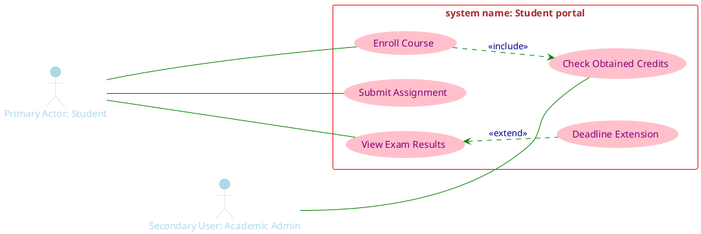

**User Story vs. Use Case Diagram:** a user story explains what a user wants and why. A use case diagram visually shows which actors use which system functions. One use case can cover one or more related user stories.

## 6. Use Case Description

A **Use Case Description** explains one use case in more detail. It describes the interaction between the actor(s) and the system.

| Component                                    | Meaning                                                                                      |
| -------------------------------------------- | -------------------------------------------------------------------------------------------- |
| **Use Case name**                            | Short action name, e.g. `Withdraw Cash`.                                                     |
| **Goal**                                     | What the actor wants to achieve.                                                             |
| **Actor(s)**                                 | Primary, supporting and offstage actors involved. Do not list the system itself as an actor. |
| **Precondition**                             | What must already be true before the use case can start.                                     |
| **Postcondition**                            | What is true after the use case succeeds.                                                    |
| **Trigger event**                            | The event that causes the use case to start.                                                 |
| **Main Success Scenario (MSS) / Happy Flow** | The normal step-by-step interaction when everything goes well.                               |
| **Alternative scenarios**                    | Exceptions or variations, e.g. wrong PIN or insufficient balance.                            |

### Points to remember

- The trigger must not simply repeat the first step of the MSS. It explains what causes the use case to start.
- A precondition must be true before the MSS can start. If it is not met, the use case cannot begin.
- An alternative scenario handles something that may go differently while the system is running, such as a failed payment.
- The MSS and each alternative should usually have no more than **10–15 steps**. If there are too many, consider splitting the work into another use case.
- Keep the description complete and unambiguous. Include relevant exceptions; do not assume everything always goes smoothly.
- A use case usually represents one business process: **one actor, one place and one moment**.

Example of a Happy Flow — ATM:

1. ATM requests PIN.
2. Customer enters PIN.
3. ATM reads card data.
4. ATM sends PIN and account to Bank.
5. Bank verifies PIN.
6. ATM prompts for amount.
7. Customer enters amount.
8. ATM sends request to Bank.
9. Bank approves.
10. ATM dispenses cash.
11. ATM returns card.
12. Customer takes card and cash.

## 7. Story Mapping

A **Story Map** is another visual way to organise user stories. It arranges the stories in the order of the user's journey, so the team can see the whole product instead of focusing only on separate small requirements.

### Levels of a story map

- **Journey / Backbone:** the overall user journey from beginning to end.
- **Activities:** the major stages of that journey. Use verb + noun.
- **Steps:** the main tasks inside each activity, ordered from left to right.
- **User stories / details:** the smaller pieces of functionality under each step.

### How to create a story map

1. Determine the user, the problem and the goal (**who, what, why**).
2. Write the backbone: the user's journey from start to finish.
3. Group the steps into major activities.
4. Add and split the user stories under the correct steps.
5. Prioritise the stories. Higher priority goes near the top.
6. Define releases by making vertical cuts through the map.

### MVP and releases

The **MVP (Minimum Viable Product)** is the smallest useful version of the product. It should let the user complete the core journey. In a story map, the MVP is a **horizontal slice** across the activities, not one entire activity only.

- **Release 1 / MVP:** core features needed to complete the main journey.
- **Release 2:** useful improvements that are not essential for the first working version.
- **Release 3:** more advanced features that can be added later.

## 8. Wireframes

A **wireframe** is a simple layout of an app or website. It shows what information appears on a screen, where it is placed and how the user moves between screens. It is like a blueprint: focus on layout and interaction, not on colors, fonts or final styling.

The design steps are:

```text
Sketch  →  Wireframe  →  Mock-up  →  Prototype
```

### Creating a wireframe

1. **Prepare:** understand the users and their needs; use user stories or use cases.
2. **Choose screens:** decide which screens are needed and the order users move through them.
3. **Sketch the layout:** place the important information, menus and buttons where users expect them.
4. **Review together:** check whether the layout supports the user's goal.
5. **Add explanations:** add labels, navigation, headers and notes for important actions.
6. **Test with users:** collect feedback and adjust the wireframes.

Keep wireframes clear and simple. They can change as the team learns more about the users.

## 9. Class Diagram / Conceptual Domain Model

A **conceptual domain model** shows the important concepts in the business, their attributes and how they are connected. It describes the problem domain, not the technical implementation.

### What should not become a class?

Your notes list these as candidates to remove or classify differently:

- **Vague terms:** `system`, `information`, `data`, `process`.
- **Technical terms outside the business domain:** `scanner`, `email`, `database`, `UI`, `JSON`.
- **Synonyms or plurals:** choose one clear class name.
- **Simple data types:** number, date, string and boolean are usually attributes, not classes.
- **Properties of another concept:** e.g. restaurant name is an attribute of `Restaurant`.
- **Specific objects:** McDonald's is an object of `Restaurant`, not a class.
- **External actors without stored state:** do not create a class just because an actor interacts with the system.

A good class usually represents something the business needs to track over time and that has several properties or its own identity.

### Five-step method

1. **Search for concepts:** underline nouns and noun phrases in the business case.
2. **Filter candidates:** decide which nouns should be classes, attributes, associations, enumeration values or should be left out.
3. **Draw classes:** use rectangles and singular PascalCase names.
4. **Add attributes and associations:** list the important data and connect related concepts.
5. **Validate:** create sample objects in an object diagram and check whether the relationships make sense.

### Useful patterns for finding concepts

- **Transaction:** turn an important business action into a concept, e.g. ordering food → `Order`.
- **Consumer / Supplier:** identify who receives and who provides the goods or service in a transaction.
- **Product / Service:** identify what is being exchanged, e.g. `MenuItem`.
- **Whole / Part:** check whether a concept is made of smaller parts, e.g. `Order` and `OrderItem`.
- **Description:** keep reusable catalogue information in one class, rather than copying it into every transaction.

### QuickBite class diagram from your notes

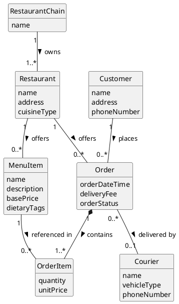

For the conceptual model, use singular **PascalCase** for class names and **camelCase** for attributes. Do not add methods or visibility markers (`+`, `-`, `#`) at this analysis stage.

## 10. Composition

**Composition** is a strong whole/part relationship. The part belongs to one whole and its lifecycle depends on that whole. In the diagram, the black diamond is placed at the whole side.

Example: an `Order` contains one or more `OrderItem`s. An `OrderItem` belongs to exactly one `Order`.

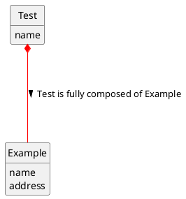

## 11. Multiplicity and Business Rules

**Multiplicity** describes how many instances of one class can be connected to one instance of another class. It is written at both ends of an association.

| Multiplicity  | Meaning                       |
| ------------- | ----------------------------- |
| `1` or `1..1` | Exactly one                   |
| `0..1`        | Zero or one (optional)        |
| `*` or `0..*` | Zero or more                  |
| `1..*`        | One or more                   |
| `m..n`        | A specific range, e.g. `1..2` |

Always read the association from the perspective of **one instance** of the class at the opposite end. Check both directions. Each multiplicity expresses a business rule.

Example: one `RestaurantChain` owns one or more `Restaurant`s. Each `Restaurant` belongs to exactly one `RestaurantChain`.

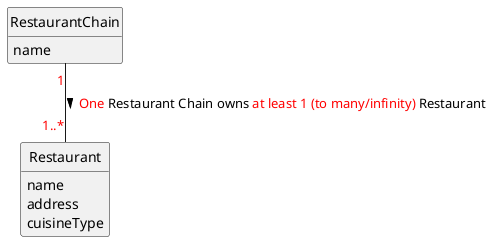

## 12. Generalisation

**Generalisation** means inheritance: a subclass is a more specific type of a superclass and inherits its attributes and associations.

Example: `Junior` and `Senior` are both types of `Waiter`.

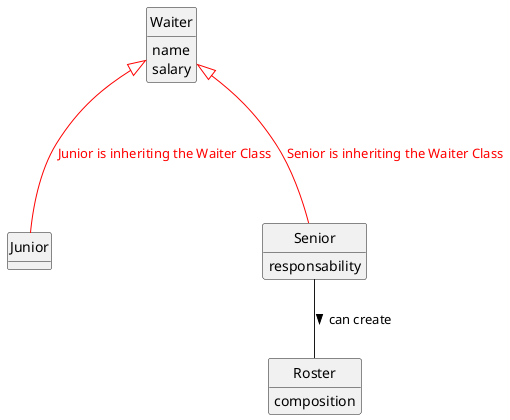

### The four rules of generalisation

All four rules must be respected:

| Rule          | Question                                                                | Example                                                              |
| ------------- | ----------------------------------------------------------------------- | -------------------------------------------------------------------- |
| **Is-A**      | Is every subclass object also an object of the superclass?              | A Patient is a Member.                                               |
| **100%**      | Does every subclass inherit all superclass attributes and associations? | A Patient has all the properties of Member.                          |
| **Static**    | Does the object stay in the same subclass throughout its lifetime?      | A Customer should not later change into a Courier subclass.          |
| **Exclusive** | Can an object belong to only one subclass at a time?                    | A person should not be both Customer and Courier subclasses at once. |

The **Is-A** and **100%** rules were introduced in Week 04. **Static** and **Exclusive** complete the check in Week 05.

### When it is not generalisation: enumeration or association

Use an **enumeration** when the options are just fixed values and do not need their own attributes, relationships or lifecycle.

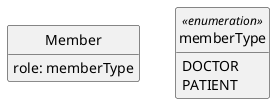

Use an **association** when `Patient` and `Doctor` are separate concepts with their own information or connections to other classes.

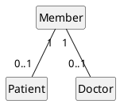

## 13. Modeling History

Modeling history means keeping what happened in the past, not only the current situation.

For example, if a menu item costs €12.50 when an order is placed and the price changes to €14 later, the old order must still show €12.50.

**Remember:**

For example, if a menu item costs €12.50 when an order is placed and the price changes to €14 later, the old order must still show €12.50.

**Remember:**

- **Catalogue facts:** what is offered now, e.g. `MenuItem.basePrice`.
- **Transaction facts:** what happened at the time of purchase, e.g. `OrderItem.unitPriceAtPurchase`.

When the system keeps all past orders, a customer can have `0..*` orders. Do not model only the current order if the business needs order history.

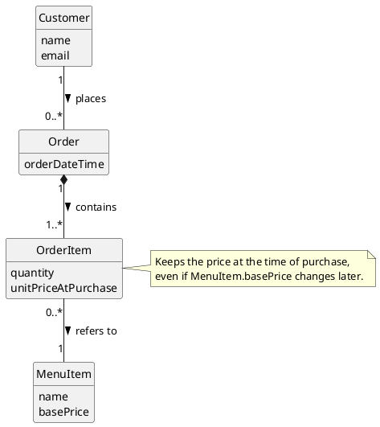

## 14. Solving Many-to-Many Associations

In QuickBite, one `Order` can contain many `MenuItem`s, and one `MenuItem` can appear in many `Order`s. This is a **many-to-many (M:N)** association.

The problem is that the link itself has information: **how many** were ordered and **what price** was paid. That information belongs to the purchase line, not to the menu item itself.

### Intermediate class — `OrderItem`

Create a normal class between the two original classes. It has its own identity and attributes, such as `quantity` and `unitPriceAtPurchase`.

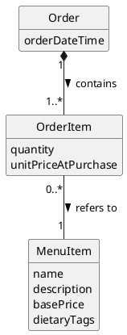

This is useful when a line needs its own details or lifecycle. It also allows the same menu item to appear on separate lines of an order.

### Association class

An **association class** is attached to the association line with a dashed connection. It stores information about the relationship itself. It allows at most one association-class instance for a given pair of linked objects.

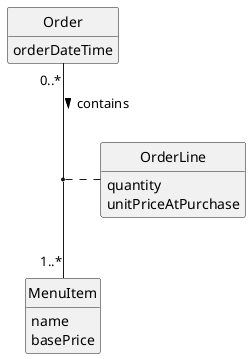

### Description pattern

Keep the reusable description in one class and refer to it from transactions:

- `MenuItem` stores the catalogue information: name, description and current base price.
- `OrderItem` stores details of this specific purchase: quantity and the price paid.

**Described once, sold many times.**

## 15. Notes and Constraints

### Notes

A **UML note** adds an explanation, assumption or context to a class or association. It does not enforce a rule.

### Constraints

A **constraint** is a strict rule that must always be true. Write it between curly braces `{ }`.

Examples:

- `{quantity >= 1}`
- `{deliveryFee >= 0.0}`
- `{estimatedDelivery >= orderDateTime}`

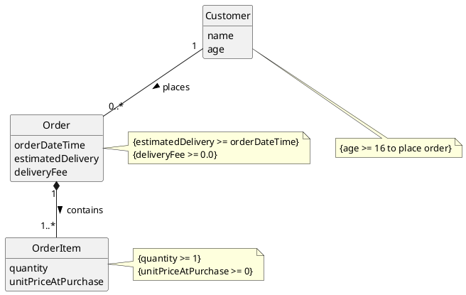

## 16. Enumerations

An **enumeration** (`<<enumeration>>`) is a fixed list of allowed values for an attribute. It prevents inconsistent free-text values, such as `delivered`, `Delivered` and `DELIVRD`.

Use an enumeration when the values are known and limited, e.g. order status. Write the enumeration name as the attribute type. No separate association arrow is needed.

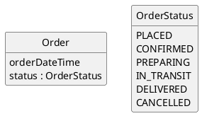

## 17 Glossary

| Term                              | Definition                                                                                                                         |
| --------------------------------- | ---------------------------------------------------------------------------------------------------------------------------------- |
| **Acceptance criteria**           | Testable conditions that determine whether a user story is complete and works as expected.                                         |
| **Actor**                         | A role played by a person, external system or device that interacts with the System under Development.                             |
| **Agile**                         | An iterative development approach that uses feedback and regular deliveries to adapt the product.                                  |
| **Analysis**                      | The phase concerned with understanding the problem, user needs and what the system must do or remember.                            |
| **Association**                   | A relationship between classes in a class/domain model.                                                                            |
| **Association class**             | A UML class attached to an association to describe information belonging to that specific link.                                    |
| **Attribute**                     | A named property that describes a class's objects.                                                                                 |
| **Attribute value**               | A specific value assigned to an attribute of one object.                                                                           |
| **Class**                         | A blueprint describing the common structure and behaviour of its objects.                                                          |
| **Composition**                   | A strong whole/part relationship with a filled diamond at the whole end; the part belongs to that whole in the course example.     |
| **Conceptual Domain Model (CDM)** | An analysis model of domain concepts, their attributes and their relationships.                                                    |
| **Constraint**                    | A strict condition, usually in `{ ... }`, that must always be true for the model to remain valid.                                  |
| **Decomposition**                 | Breaking a complex problem into smaller, more understandable parts.                                                                |
| **Derived attribute**             | An attribute calculated from other information; shown with a leading `/`.                                                          |
| **Epic**                          | A large user goal or feature area split into smaller user stories.                                                                 |
| **Enumeration**                   | A fixed, closed list of allowed values for an attribute.                                                                           |
| **FURPS**                         | A framework grouping Functionality, Usability, Reliability, Performance and Supportability.                                        |
| **Generalisation**                | An inheritance relationship in which every subclass object is also an object of the superclass.                                    |
| **Identity**                      | What distinguishes one particular object from other objects.                                                                       |
| **Link**                          | A concrete relationship between object instances.                                                                                  |
| **Main Success Scenario (MSS)**   | The step-by-step normal successful flow of a use case.                                                                             |
| **Multiplicity**                  | The number or range of objects that may participate in an association for one object at the other end.                             |
| **Non-functional requirement**    | A quality standard or constraint describing how well a system performs or is experienced.                                          |
| **Object**                        | One identifiable instance of a class, with its own identity, state and behaviour.                                                  |
| **Object diagram**                | A UML diagram showing concrete object instances, attribute values and links.                                                       |
| **OOA**                           | Object-Oriented Analysis: modelling the problem domain and its requirements.                                                       |
| **OOD**                           | Object-Oriented Design: designing the software structure and object collaboration.                                                 |
| **OOP**                           | Object-Oriented Programming: implementing the design in code.                                                                      |
| **Precondition**                  | A fact that must be true before a use case's Main Success Scenario can begin.                                                      |
| **Postcondition**                 | A fact that is true after the successful completion of a use case.                                                                 |
| **Requirement**                   | Something the system or project must meet.                                                                                         |
| **SDLC**                          | Software Development Life Cycle: the phases from analysis through maintenance.                                                     |
| **Sprint**                        | A short, fixed Agile development period, usually 1–4 weeks in the notes.                                                           |
| **State**                         | The collection of current attribute values of an object.                                                                           |
| **Story map**                     | A visual arrangement of user stories along a user's journey, grouped by activities and steps and used to plan priorities/releases. |
| **SuD**                           | System under Development: the system or subsystem whose functionality is being analysed.                                           |
| **Trigger event**                 | The event that directly causes a use case to start.                                                                                |
| **Use case**                      | A concrete system function that supports an actor's goal.                                                                          |
| **Use-case description**          | A structured explanation of one use case's goal, actors, conditions, trigger, normal flow and alternatives.                        |
| **Use-case diagram**              | A visual model of actors, use cases and their relationships within a system boundary.                                              |
| **User story**                    | A short functional requirement written from a user's perspective, usually “As a…, I want…, so that…”.                              |
| **Waterfall**                     | A sequential SDLC approach in which phases are normally completed in order.                                                        |
| **Wireframe**                     | A low-to-mid-fidelity representation of screen structure, content layout and navigation.                                           |

## Quick reminders

- **Analysis** = what the system must do; **Design** = how it will do it.
- **User Story** = one user goal; **Epic** = a larger group of functionality.
- **Use Case Diagram** = who uses which function; **Use Case Description** = how one use case proceeds.
- **Story Map** = user journey, activities, steps and stories; **Wireframe** = screen layout and navigation.
- **Class** = blueprint; **Object** = instance; **State** = current property values.
- **Multiplicity** = how many objects can be connected; read both ends.
- **Composition** = strong whole/part relationship.
- **Generalisation** = inheritance; check Is-A, 100%, Static and Exclusive.
- **Catalogue data** is not the same as **transaction history**.
- **Intermediate class** stores details of a many-to-many relationship.
- **Note** explains; **constraint** enforces; **enumeration** lists fixed allowed values.
