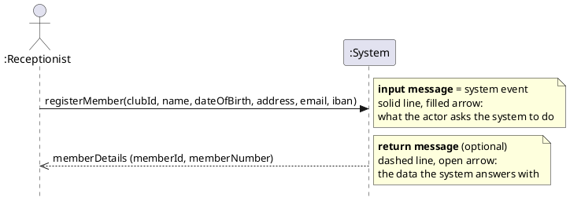
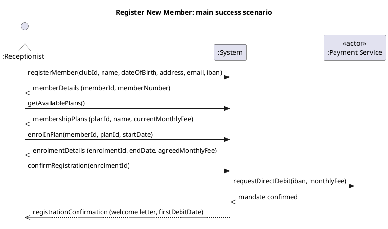
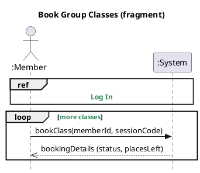

# Conceptual Thinking: Term 2 Summary

## Table of contents

- [Conceptual Thinking: Term 2 Summary](#conceptual-thinking-term-2-summary)
  - [Table of contents](#table-of-contents)
  - [System Sequence Diagram (SSD)](#system-sequence-diagram-ssd)
    - [How to draw an SSD](#how-to-draw-an-ssd)
    - [Basic SSD example](#basic-ssd-example)
    - [Input message rules](#input-message-rules)
    - [Parameters](#parameters)
    - [Full SSD example — Register New Member](#full-ssd-example--register-new-member)
    - [`ref` and `loop`](#ref-and-loop)
  - [System Events and System Operations](#system-events-and-system-operations)
  - [Stateful vs. Stateless](#stateful-vs-stateless)
  - [Operation Contract (OC)](#operation-contract-oc)
    - [Parts of an Operation Contract](#parts-of-an-operation-contract)
    - [Three types of postcondition](#three-types-of-postcondition)
    - [Example — OC1: `registerMember`](#example--oc1-registermember)
    - [OC rules to remember](#oc-rules-to-remember)
  - [CRUD check](#crud-check)

## System Sequence Diagram (SSD)

An **SSD** shows the interaction between an actor and the system for one use-case scenario.

The system is a **black box**: we only show what goes in and what comes out, not what happens inside.

### How to draw an SSD

1. **Actors:** Primary actor on the left, `:System` as one participant, secondary actors on the right. Put `:` before participant names. Mark an external actor with `<<actor>>`.
2. **Title:** Use the use-case name and scenario, for example `Register New Member: main success scenario`.
3. **Input messages:** One for every actor action that asks the system to do something. Use a verb from the use-case step.
4. **Parameters:** Include the data the system needs. Take it from the domain model.
5. **Return messages:** Optional. Use a noun for the returned data. Group the data the actor needs into one result; do not just return `OK`.

**Arrows:**

- Solid line with filled arrow: input message (actor → system).
- Dashed line with open arrow: return message (system → actor).
- Read messages from top to bottom.

### Basic SSD example

### Input message rules

- Use the verb from the use-case step and write it as a command.
- Name the **intention**, not the technical solution.
- Keep it abstract; do not mention buttons, screens or devices.

Example: `checkIn(turnstileCode, memberNumber)` is better than `scanCard()`.

### Parameters

Parameters are the data the system needs for that message. Take them from the domain model.

The system is **stateless** in this course example: it does not remember previous interactions. Therefore, send the identifiers it needs each time.

For `Register New Member`:

- `registerMember(...)` receives `clubId` and the new member's details.
- `enrolInPlan(...)` receives `memberId`, `planId` and `startDate`.
- `confirmRegistration(...)` receives `enrolmentId`.

### Full SSD example — Register New Member

### `ref` and `loop`

- **`ref`:** Refers to another interaction/sequence diagram instead of repeating its steps. Useful for a use case such as `Log In` that is reused.
- **`loop`:** Repeats a group of messages while a condition is true or for a number of times. Put the condition in the frame, for example `more classes`.

## System Events and System Operations

- **System event:** The call/message sent to the system. It is the input arrow in the SSD.
- **System operation:** The work the system performs after receiving that call.

They have the same name and parameters. For example, the event `registerMember(...)` calls the system operation `registerMember(...)`.

## Stateful vs. Stateless

- **Stateful:** The system remembers information from earlier interactions. Its next response can depend on that information. Example: a shopping cart that still contains products when the customer checks out.
- **Stateless:** Each request is handled separately. The system does not rely on information from earlier requests. The required information must be sent again, often using IDs.

## Operation Contract (OC)

An **Operation Contract** describes:

- **Preconditions:** What must already be true before the operation.
- **Postconditions:** What has changed after the operation.

Write an OC for each system operation that changes something. Use the operations from the SSD and the classes, attributes and associations from the domain model.

### Parts of an Operation Contract

| Part             | What to write                                                       |
| ---------------- | ------------------------------------------------------------------- |
| Operation        | The input message from the SSD, with its parameters (no types yet). |
| Cross references | The use case the operation belongs to.                              |
| Preconditions    | The objects that must already exist.                                |
| Postconditions   | The changes made to the domain model.                               |

For a precondition, use this format:

`A <Class> <object> with <object>.<attributeID> = <attributeID> was present.`

### Three types of postcondition

1. **Instance created/deleted:** An object was created or deleted.
2. **Link formed/broken:** An association between objects was created or removed.
3. **Attribute changed:** An attribute received a new value.

Write postconditions in the **past tense** and describe the result, not the steps the system takes.

### Example — OC1: `registerMember`

| Part             | OC1: `registerMember`                                                                                                                                                                                                                              |
| ---------------- | -------------------------------------------------------------------------------------------------------------------------------------------------------------------------------------------------------------------------------------------------- |
| Operation        | `registerMember(clubId, name, dateOfBirth, address, email, iban)`                                                                                                                                                                                  |
| Cross references | Use case: Register New Member                                                                                                                                                                                                                      |
| Preconditions    | A `Club` c with `c.clubId = clubId` was present.                                                                                                                                                                                                   |
| Postconditions   | A `Member` m was created.   m was linked to the `Club` c. `m.memberId` became a new, unique ID; `m.memberNumber` became a new, unique number. `m.name`, `m.dateOfBirth`, `m.address`, `m.email` and `m.iban` became the parameter values. |

### OC rules to remember

- Describe the **result**, not the algorithm. Do not write steps such as “the system looks up the plan”.
- Use past tense: `was created`, `was linked`, `became`.
- When you create an object, also say what it is linked to.
- Use the exact class, association and attribute names from the domain model. If something is missing, update the domain model.
- Do not write an OC for an operation that only reads information.

## CRUD check

Use CRUD to decide whether an operation needs an OC:

| Type           | Meaning                                                                      | Operation Contract? |
| -------------- | ---------------------------------------------------------------------------- | ------------------- |
| **C — Create** | Creates a new object.                                                        | Yes                 |
| **R — Read**   | Only retrieves information.                                                  | No                  |
| **U — Update** | Changes an attribute.                                                        | Yes                 |
| **D — Delete** | Deletes an object (often archived instead, except for data privacy reasons). | Yes                 |
| **U — Update** | Changes an attribute.                                                        | Yes                 |
| **D — Delete** | Deletes an object (often archived instead, except for data privacy reasons). | Yes                 |
