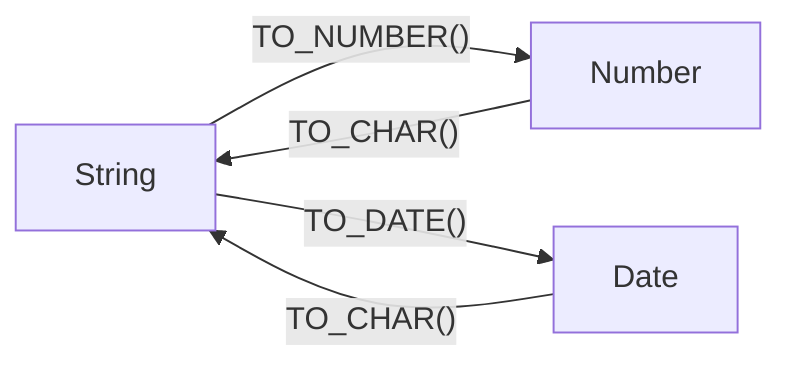

# Relational Database Fundamentals

## Table of contents

- [Relational Database Fundamentals](#relational-database-fundamentals)
  - [Table of contents](#table-of-contents)
  - [1. SQL Functions](#1-sql-functions)
    - [1.1 Text functions](#11-text-functions)
    - [1.2 Numeric functions](#12-numeric-functions)
    - [1.3 Date and time functions](#13-date-and-time-functions)
    - [1.4 Conversion functions](#14-conversion-functions)
    - [1.5 Aggregate functions](#15-aggregate-functions)
  - [2. Database basics](#2-database-basics)
  - [3. Queries](#3-queries)
  - [4. Selecting columns and concatenation](#4-selecting-columns-and-concatenation)
  - [5. Filtering rows with WHERE](#5-filtering-rows-with-where)
  - [6. Sorting and limiting results](#6-sorting-and-limiting-results)
  - [7. GROUP BY and HAVING](#7-group-by-and-having)
  - [8. Joins](#8-joins)
    - [Inner join](#inner-join)
    - [Joining several tables](#joining-several-tables)
    - [Composite keys](#composite-keys)
    - [Non-equi join](#non-equi-join)
    - [Self join](#self-join)
      - [Common uses](#common-uses)
    - [Outer joins](#outer-joins)
    - [Rows without a match](#rows-without-a-match)
  - [9. Quick summary](#9-quick-summary)

---

## 1. SQL Functions

A function takes a value, performs an operation, and returns a result.

### 1.1 Text functions

Used to change, examine, or extract text.

| Function                  | What it does                                               | Example                                   |
| ------------------------- | ---------------------------------------------------------- | ----------------------------------------- |
| `UPPER(text)`             | Converts text to uppercase.                                | `UPPER('john')` → `JOHN`                  |
| `LOWER(text)`             | Converts text to lowercase.                                | `LOWER('JOHN')` → `john`                  |
| `INITCAP(text)`           | Capitalizes each word.                                     | `INITCAP('john smith')` → `John Smith`    |
| `LENGTH(text)`            | Counts characters.                                         | `LENGTH('John')` → `4`                    |
| `SUBSTR(text, start, n)`  | Extracts part of text.                                     | `SUBSTR('John', 1, 2)` → `Jo`             |
| `LEFT(text, n)`           | Returns the first `n` characters.                          | `LEFT('John', 2)` → `Jo`                  |
| `POSITION(x IN text)`     | Finds the position of text; returns `0` if not found.      | `POSITION('o' IN 'John')` → `2`           |
| `REPLACE(text, old, new)` | Replaces every occurrence.                                 | `REPLACE('banana', 'a', 'o')` → `bonono`  |
| `TRIM(text)`              | Removes spaces from both ends.                             | `TRIM(' John ')` → `John`                 |
| `LTRIM(text, chars)`      | Removes specified characters from the left.                | `LTRIM('zzzJohn', 'z')` → `John`          |
| `LPAD(text, n, fill)`     | Adds characters on the left.                               | `LPAD('7', 3, '0')` → `007`               |
| `RPAD(text, n, fill)`     | Adds characters on the right.                              | `RPAD('7', 3, '0')` → `700`               |
| `CONCAT(a, b)`            | Combines values.                                           | `CONCAT('John', ' Smith')` → `John Smith` |
| `CONCAT_WS(sep, a, b)`    | Combines values using a separator; skips `NULL` arguments. | `CONCAT_WS('-', 'A', 'B')` → `A-B`        |

Example:

```sql
SELECT UPPER(last_name), LENGTH(last_name)
FROM employees;
```

Returns each employee's surname in uppercase and its character count.

Functions can be **nested**; the innermost one runs first:

```sql
SELECT RPAD(LTRIM(LOWER(street), 'z'), 30, '*')
FROM employees;
```

Lowercases the street, removes leading `z` characters, then pads it to 30 characters with `*`.
E.g. if the street is `'ZzGroenplaatzZ'` -> `groenplaatzz******************`

### 1.2 Numeric functions

Used to calculate or change numbers.

| Function      | What it does                                   | Example                    |
| ------------- | ---------------------------------------------- | -------------------------- |
| `ROUND(n, d)` | Rounds to `d` decimal places.                  | `ROUND(4.567, 2)` → `4.57` |
| `TRUNC(n, d)` | Removes extra decimal places without rounding. | `TRUNC(4.567, 2)` → `4.56` |
| `MOD(a, b)`   | Returns the remainder after division.          | `MOD(5, 3)` → `2`          |

- `ROUND(15256, -1)` → `15260` (rounds to the nearest ten).
- `TRUNC(15256, -1)` → `15250` (cuts off the units digit).

Normal arithmetic operators: `+`, `-`, `*`, `/`.

### 1.3 Date and time functions

Used to get dates, calculate ages, and extract date information.

| Function                   | What it does                                  |
| -------------------------- | --------------------------------------------- |
| `CURRENT_DATE`             | Returns today's date.                         |
| `CURRENT_TIME`             | Returns the current time.                     |
| `NOW()`                    | Returns the current date and time.            |
| `AGE(date)`                | Calculates the time between a date and today. |
| `AGE(date1, date2)`        | Calculates the time between two dates.        |
| `EXTRACT(YEAR FROM date)`  | Extracts the year.                            |
| `EXTRACT(MONTH FROM date)` | Extracts the month.                           |
| `EXTRACT(DAY FROM date)`   | Extracts the day.                             |
| `DATE_PART('year', date)`  | Another way to extract a date part.           |

Examples:

```sql
SELECT AGE(birth_date)
FROM employees;
```

Returns each employee's age as a time interval.

```sql
SELECT *
FROM employees
WHERE EXTRACT(YEAR FROM birth_date) = 1990;
```

Returns employees born in 1990.

**Working with ages:**

```sql
WHERE AGE(birth_date) > '30 years'
```

An age (interval) can be compared with an interval written as text.

```sql
WHERE EXTRACT(YEAR FROM AGE(birth_date)) BETWEEN 30 AND 35
```

`EXTRACT` on an `AGE` result gives the age in whole years.

```sql
SELECT DATE_PART('months', AGE(CURRENT_DATE, TO_DATE('01-09-2021', 'DD-MM-YYYY')));
```

Returns the months part of the time between two dates. Age-based results depend on **today's date**.

**Date calculations:**

```sql
CURRENT_DATE - birth_date
```

Returns the number of days between the dates.

```sql
birth_date + INTERVAL '65 years'
```

Returns the date 65 years after the birth date.

### 1.4 Conversion functions

Used to change a value from one data type to another.

| Function                  | What it does                          | Example                               |
| ------------------------- | ------------------------------------- | ------------------------------------- |
| `TO_CHAR(value, format)`  | Converts a date or number to text.    | `TO_CHAR(birth_date, 'DD-MM-YYYY')`   |
| `TO_DATE(text, format)`   | Converts text to a date.              | `TO_DATE('2021-10-29', 'YYYY-MM-DD')` |
| `TO_NUMBER(text, format)` | Converts text to a number.            | `TO_NUMBER('2500', '9999')` → `2500`  |
| `CAST(value AS type)`     | Converts a value to a specified type. | `CAST(employee_id AS INT)`            |

PostgreSQL also accepts the shorthand `value::type`, e.g. `zip::integer`.



**Useful date formats for `TO_CHAR`:**

| Format     | Meaning                | Example (29 Oct 2021) |
| ---------- | ---------------------- | --------------------- |
| `YYYY`     | Four-digit year        | 2021                  |
| `MM`       | Month number           | 10                    |
| `DD`       | Day number             | 29                    |
| `Month`    | Full month name        | October               |
| `Mon`      | Short month name       | Oct                   |
| `Day`      | Day of the week        | Friday                |
| `dy`       | Short day of the week  | fri                   |
| `DDTH`     | Day with suffix        | 29TH (`DDth` → 29th)  |
| `WWth`     | Week of the year       | 44th                  |
| `HH24:MI`  | Time in 24-hour format | 20:38                 |
| `HH:MI AM` | Time in 12-hour format | 08:38 PM              |

The **case of the format code sets the case of the output**: `Month` → `October`, `month` → `october`, `day` → `friday`.

**Prefixes:**

- `FM` (fill mode) removes the padding spaces that `Month` and `Day` add.
- `TM` (translation mode) prints names in the language set by `lc_time`.

Example:

```sql
SELECT TO_CHAR(birth_date, 'DD Month YYYY')
FROM employees;
```

Displays `29 October   2021`: the month name is **padded with spaces**. Fix it with `FM`:

```sql
SELECT TO_CHAR(birth_date, 'DD FMMonth YYYY')
FROM employees;
```

Displays `29 October 2021`.

```sql
SET lc_time = 'fr_BE';
SELECT TO_CHAR(birth_date, 'TMday DD TMMonth YYYY')
FROM family_members;
```

Displays the day and month names in French.

**Important:** always specify the year when using `TO_DATE`.

### 1.5 Aggregate functions

Used to calculate a result from multiple rows. See [7. GROUP BY and HAVING](#7-group-by-and-having) to create an aggregation.

| Function                 | What it does                                |
| ------------------------ | ------------------------------------------- |
| `COUNT(*)`               | Counts all rows.                            |
| `COUNT(column)`          | Counts rows where the column is not `NULL`. |
| `COUNT(DISTINCT column)` | Counts different, non-`NULL` values.        |
| `SUM(column)`            | Adds numeric values.                        |
| `AVG(column)`            | Calculates the average.                     |
| `MIN(column)`            | Finds the smallest value.                   |
| `MAX(column)`            | Finds the largest value.                    |

Examples:

```sql
SELECT COUNT(*)
FROM employees;
```

Counts all employees.

```sql
SELECT AVG(salary), MAX(salary), MIN(salary)
FROM employees;
```

Returns the average, highest, and lowest known salary.

```sql
SELECT MIN(description), MAX(description) FROM courses;       -- first / last alphabetically
SELECT MIN(enroll_date), MAX(enroll_date) FROM enrollments;   -- oldest / most recent date
SELECT ROUND(AVG(LENGTH(last_name))) FROM employees;          -- a function inside an aggregate
```

`MIN`/`MAX` also work on **text** and **dates**, and a function can be used **inside** an aggregate.

**Important rules:**

- Most aggregates ignore `NULL` values; `COUNT(*)` counts all rows.
- Without `GROUP BY`, an aggregate normally returns one result row, so every column in `SELECT` must be an aggregate: `SELECT employee_id, SUM(hours) FROM tasks;` is an error.
- Aggregates are **not allowed in `WHERE`**: `WHERE AVG(salary) > 30000` is an error. Use `HAVING`.
- Use `WHERE` to filter rows before calculating aggregates.
- Use `HAVING` to filter groups based on aggregate results.

---

## 2. Database basics

| Term                   | Meaning                                                                                                           |
| ---------------------- | ----------------------------------------------------------------------------------------------------------------- |
| **Entity (Table)**     | Stores related data, e.g., `employees`.                                                                           |
| **Value (Row)**        | One record in a table.                                                                                            |
| **Attribute (Column)** | One property, e.g., `last_name`.                                                                                  |
| **Primary key: PK**    | Uniquely identifies each row and cannot be `NULL`.                                                                |
| **Foreign key: FK**    | A column or set of columns that references a key in the same or another table, maintaining referential integrity. |
| **Composite key**      | A key made up of two or more columns that together identify a row uniquely.                                       |
| **UNIQUE: UQ**         | A constraint that prevents duplicate values in a column or combination of columns. Also called `Alternative Key`. |
| **NOT NULL: NN**       | Requires a value; the column cannot be empty ( `NULL`).                                                           |
| **NULL**               | No value / unknown. It is not `0` and not an empty text.                                                          |

---

## 3. Queries

```sql
SELECT columns
FROM table
WHERE condition
ORDER BY column;
```

| Clause                                  | Purpose                                                                                                                                                   | Example                                                 |
| --------------------------------------- | --------------------------------------------------------------------------------------------------------------------------------------------------------- | ------------------------------------------------------- |
| `SELECT` (DISTINCT) [attributes]        | Chooses columns. If `DISTINCT`, duplicate rows will be removed. Also see [4. Selecting columns and concatenation](#4-selecting-columns-and-concatenation) | `SELECT DISTINCT department_id, department_name`        |
| `FROM` [table] (alias)                  | Chooses the table.                                                                                                                                        | `FROM department d`                                     |
| `JOIN` [table] (alias) `ON` [condition] | Combines tables. See [8. Joins](#8-joins)                                                                                                                 | `JOIN employees e ON e.department_id = d.department_id` |
| `WHERE` [condition]                     | Filters rows. See [5. Filtering rows with WHERE](#5-filtering-rows-with-where)                                                                            | `WHERE e.salary > 30000`                                |
| `GROUP BY` [attributes]                 | Groups rows. See [7. GROUP BY and HAVING](#7-group-by-and-having)                                                                                         | `GROUP BY d.department_id`                              |
| `HAVING` [condition (aggregated)]       | Filters groups. See [7. GROUP BY and HAVING](#7-group-by-and-having)                                                                                      | `HAVING COUNT(*) > 5`                                   |
| `ORDER BY` [attributes] (ASC/DESC)      | Sorts results. See [6. Sorting and limiting results](#6-sorting-and-limiting-results)                                                                     | `ORDER BY salary DESC`                                  |
| `FETCH NEXT` [number] `ROWS ONLY`       | Limits the number of results. See [6. Sorting and limiting results](#6-sorting-and-limiting-results)                                                      | `FETCH NEXT 5 ROWS ONLY`                                |
| `OFFSET` [number]                       | Skips rows.                                                                                                                                               | `OFFSET 10`                                             |

Logical execution order:

`SELECT → FROM → JOIN → WHERE → GROUP BY → HAVING →  DISTINCsT → ORDER BY → OFFSET → FETCH`

---

## 4. Selecting columns and concatenation

```sql
SELECT * FROM employees;
```

Returns all columns.

```sql
SELECT first_name AS name
FROM employees;
```

`AS` gives a column a temporary name, called an alias.

- `AS` is optional: `first_name name`.
- Unquoted aliases become lower case. Use **double quotes** for spaces or capitals: `first_name AS "First Name"`.
- Tables can have aliases too: `FROM employees e`, then `e.last_name`.
- **Single quotes** are for text/date values (`'Smith'`), **double quotes** for names (aliases).

```sql
SELECT DISTINCT department_id
FROM employees;
```

Returns each department only once.

- `DISTINCT` applies to the **whole row** of selected columns: `SELECT DISTINCT department_id, salary` returns unique combinations.
- With `DISTINCT`, you can only `ORDER BY` columns that are in the `SELECT` list.
- `DISTINCT ON (expression)` keeps one row per value of the expression: `SELECT DISTINCT ON (LOWER(location)) location FROM employees;`

Constants and calculations can be selected too, and `SELECT` works without `FROM`:

```sql
SELECT CURRENT_DATE, 150*(1-0.15) AS calculation, 'SQL' AS course;
```

A constant is repeated on every row when selected from a table.

To combine text, use `||`:

```sql
SELECT first_name || ' ' || last_name AS full_name
FROM employees;
```

You can also use the CONCAT() function:

```sql
SELECT CONCAT(first_name, ' ', last_name) AS full_name
FROM employees;
```

---

## 5. Filtering rows with WHERE

| Operator             | Meaning                             |
| -------------------- | ----------------------------------- |
| `=`                  | Equal to                            |
| `<>` or `!=`         | Not equal to                        |
| `<`, `>`, `<=`, `>=` | Compare values                      |
| `BETWEEN a AND b`    | Within an inclusive range           |
| `IN (...)`           | Matches one of several values       |
| `LIKE`               | Matches a text pattern              |
| `IS NULL`            | Value is missing                    |
| `IS NOT NULL`        | Value exists                        |
| `AND`                | Both conditions must be true        |
| `OR`                 | At least one condition must be true |
| `NOT`                | Reverses a condition                |

Example:

```sql
SELECT *
FROM employees
WHERE salary BETWEEN 20000 AND 40000;
```

Returns employees earning between 20,000 and 40,000, including both endpoints.

**BETWEEN:**

- Put the **smaller value first**: `BETWEEN 1500 AND 1000` returns nothing.
- It works on numbers, **text** (`BETWEEN 'A' AND 'K'`) and **dates**. Zip codes are stored as text, so `zip BETWEEN '05000' AND '06825'` keeps the leading zeros.

**LIKE patterns:**
`%` = any amount of characters
`_` = one character

- `'A%'`: starts with A.
- `'%A'`: ends with A.
- `'%A%'`: contains A.
- `'A_'`: A followed by exactly one character.

**Combining and negating:**

- Use parentheses to group `AND`/`OR`: `WHERE (salary < 40000 AND department_id = 7) OR employee_id = '999666666'`.
- `NOT` can be combined with the other operators: `NOT LIKE '%oo%'`, `NOT LOWER(location) IN ('maarssen','eindhoven')`, `NOT prerequisite >= 140` (same as `< 140`).

**Text and numbers:**

- Text comparisons are **case-sensitive**. Use `LOWER()` or `UPPER()` to standardize text capitalization: `WHERE LOWER(location) = 'maarssen'`.
- Text and dates go in quotes (`employee_id = '999111111'`, `zip = '10025'`); numbers do not (`department_id = 7`).

For `NULL`, always use `IS NULL` or `IS NOT NULL`, never `= NULL`.

---

## 6. Sorting and limiting results

```sql
SELECT first_name, salary
FROM employees
ORDER BY salary DESC
LIMIT 5;
```

Returns the five highest salaries.

- `ASC` = ascending (default).
- `DESC` = descending.
- `LIMIT 5` = return at most five rows.
- `OFFSET 10` = skip the first ten rows.
- `LIMIT 5 OFFSET 10` = skip ten rows and return the next five.
- `FETCH FIRST 5 ROWS ONLY` = the standard-SQL way of writing `LIMIT 5` (placed at the very end; `FETCH NEXT` is identical).

Use `ORDER BY` when the order of results matters.

**More about ORDER BY:**

- Several columns, each with its own direction: `ORDER BY department_id DESC, first_name`.
- You can sort by an **alias** or by the **position** in the `SELECT` list: `ORDER BY 2 DESC`.
- Decide where `NULL`s appear with `NULLS FIRST` / `NULLS LAST`:

```sql
SELECT employee_id, project_id, hours
FROM tasks
ORDER BY hours DESC NULLS LAST;
```

---

## 7. GROUP BY and HAVING

`GROUP BY` creates groups and calculates an aggregate for each group.

```sql
SELECT department_id, COUNT(*)
FROM employees
GROUP BY department_id;
```

Returns the number of employees in each department.

**Rule:** every column in `SELECT` must either be **inside an aggregate** or be **listed in `GROUP BY`**.

```sql
SELECT department_id, COUNT(*), first_name   -- error: first_name is neither
FROM employees
GROUP BY department_id;
```

You can group by several columns; each **combination** forms a group: `GROUP BY department_id, location`.

**WHERE vs HAVING:**

- `WHERE` filters individual rows before grouping. Aggregates are **not allowed** here.
- `HAVING` filters groups after grouping. Aggregates are allowed, also ones that are not in `SELECT`.

```sql
SELECT department_id, COUNT(*)
FROM employees
WHERE salary > 20000
GROUP BY department_id
HAVING COUNT(*) > 5;
```

First keeps employees earning over 20,000, then groups them by department, and finally keeps departments with more than five qualifying employees.

- A condition on a plain column belongs in `WHERE`, not `HAVING`: filtering first means fewer rows to group, which performs better.
- A column that is not grouped (e.g. `gender`) cannot be tested in `HAVING`; use `WHERE`.

---

## 8. Joins

A **JOIN** combines rows from tables using related columns (e.g. `department_id`).

### Inner join

Returns only rows with a **match in both tables**.

```sql
SELECT d.department_id, department_name, project_id, project_name, location
FROM departments d
JOIN projects p ON d.department_id = p.department_id
ORDER BY department_id;
```

- **Aliases/prefixes:** Use `d.department_id` when columns exist in multiple tables to avoid ambiguity.
- **Join condition:** Always use `JOIN ... ON`. Without a condition, every row pairs with every other row (**Cartesian product**; W4Entreprise Ex 1).
- `WHERE` filters the joined results.

### Joining several tables

Chain joins using the relevant keys.

```sql
SELECT project_name, p.location,
       concat(first_name, ' ', last_name) full_name, e.department_id
FROM projects p
JOIN tasks t ON t.project_id = p.project_id
JOIN employees e ON e.employee_id = t.employee_id
ORDER BY department_id, last_name;
```

The same query can involve different department relationships: `e.department_id` = employee's department; `p.department_id` = department supporting the project (W4 Ex 4).

### Composite keys

Match **all required key columns** using `AND`.

```sql
select * FROM students s
JOIN grades g
  ON s.student_id = g.student_id
 AND s.section_id = g.section_id
```

### Non-equi join

Uses conditions other than `=`, such as ranges.

```sql
LEFT JOIN grade_conversions
  ON numeric_grade >= min_grade
 AND numeric_grade <= max_grade
```

### Self join

A **self join** joins a table to itself to compare rows or find relationships between rows in the same table. Use **different aliases** (e.g. `e1`, `e2`) to represent each occurrence as a separate table.

```sql
SELECT e1.last_name AS employee, e2.last_name AS manager
FROM employees e1
JOIN employees e2 ON e1.manager_id = e2.employee_id;
```

Here, `e1` represents the employee and `e2` their manager. The `ON` condition links the employee's `manager_id` to the manager's `employee_id`.

#### Common uses

**1. Find hierarchies:** Join the table multiple times to follow relationships, e.g. employee → manager → manager's manager.

```sql
SELECT e1.last_name AS employee,
       e2.last_name AS manager,
       e3.last_name AS manager_of_manager
FROM employees e1
JOIN employees e2 ON e1.manager_id = e2.employee_id
JOIN employees e3 ON e2.manager_id = e3.employee_id;
```

**2. Find related rows:** Match rows sharing a value, e.g. students with the same address.

```sql
SELECT s1.student_id, s2.student_id
FROM students s1
JOIN students s2
  ON s1.street_address = s2.street_address
 AND s1.zip = s2.zip
 AND s1.student_id != s2.student_id;
```

**3. Compare rows:** Compare records against each other, e.g. find employees born in the same month.

```sql
SELECT e1.last_name, e2.last_name
FROM employees e1
JOIN employees e2
  ON EXTRACT(MONTH FROM e1.birth_date) =
     EXTRACT(MONTH FROM e2.birth_date)
 AND e1.employee_id < e2.employee_id;
```

`<` lists each pair **once**. With `!=` (as in W4 Ex 7) every pair appears twice, once per direction, which gives _every_ employee who shares a birth month with someone else. Choose according to what the question asks.

**4. Compare rows with a specific record:** Find projects in the same department as project 3.

```sql
SELECT p1.project_name, p1.department_id
FROM projects p1
JOIN projects p2 ON p1.department_id = p2.department_id
WHERE p2.project_id = 3;
```

### Outer joins

Keep unmatched rows, filling missing columns with `NULL`.

| Join type                       | Rows retained                                                        |
| ------------------------------- | -------------------------------------------------------------------- |
| `[INNER] JOIN` (default `JOIN`) | Only matching rows                                                   |
| `LEFT [OUTER] JOIN`             | All rows from the left table; unmatched right-side values are `NULL` |
| `RIGHT [OUTER] JOIN`            | All rows from the right table; unmatched left-side values are `NULL` |
| `FULL [OUTER] JOIN`             | All rows from both tables; missing-side values are `NULL`            |

**TIP:** Anything that can be done by a `RIGHT JOIN` can also be done with a `LEFT JOIN`, so you don't need to learn both. You can just use `LEFT JOIN` every time because it is easier to visualize.

```sql
-- Keep all employees, including those without a department
SELECT e.employee_id, e.last_name, d.department_name, d.department_id
FROM employees e
LEFT JOIN departments d ON e.department_id = d.department_id;

-- Keep all departments, including those without employees
SELECT d.department_name, e.last_name
FROM departments d
LEFT JOIN employees e ON d.department_id = e.department_id;
```

Changing the first query to `RIGHT JOIN departments d` keeps all departments instead, and `FULL JOIN` keeps all rows from both tables.

A department without employees appears as `Research | NULL`: the `NULL` comes from the `employees` table, because there is no corresponding employee.

If on PC, you can hover over the JOINs to see which part of the two tables they keep (on Mobile, you can hold the text):

<style>
.join-diagram{font-family:Arial,sans-serif;display:flex;align-items:flex-start;gap:16px}
.join-labels{display:grid;grid-template-rows:repeat(3,70px);width:150px;margin-top:38px}
.join-label{display:flex;align-items:center;font-weight:bold;cursor:pointer;position:relative;z-index:20}
.join-area{position:relative;width:460px;height:210px}
.join-tables{display:flex;gap:20px;width:460px;height:210px}
.join-table{box-sizing:border-box;width:220px;height:210px;border:1px solid black;display:grid;grid-template-rows:repeat(3,1fr);text-align:center;background:transparent}
.join-cell{display:flex;align-items:center;justify-content:center}
.join-cell:not(:last-child){border-bottom:1px solid black}
.join-rect{position:absolute;box-sizing:border-box;pointer-events:none;transition:border-width .1s;z-index:1}
.join-left{left:0;top:74px;width:460px;height:132px;border:3px solid #1976d2}
.join-right{left:8px;top:4px;width:444px;height:132px;border:3px solid #e67e22}
.join-full{left:18px;top:0;width:424px;height:210px;border:3px solid #8e44ad}
.join-only{left:-14px;top:70px;width:488px;height:70px;border:3px solid #16a085}
.join-labels:has(.label-right:hover)~.unused{}
.join-diagram:has(.label-right:hover) .join-right,
.join-diagram:has(.label-full:hover) .join-full,
.join-diagram:has(.label-left:hover) .join-left,
.join-diagram:has(.label-only:hover) .join-only{border-width:9px;z-index:10}
</style>
<div class="join-diagram">
<div style="display:flex;flex-direction:column;width:90px;margin-top:8px;">
<div style="height:70px;"></div>
<div class="join-label label-only"  style="height:120px;display:flex;align-items:center;font-weight:bold;color:#16a085;font-size:18px;">JOIN</div>
<div style="height:70px;"></div>
</div>
<div>
<div style="display:flex;gap:20px;width:460px;margin-bottom:8px;">
<div style="width:220px;text-align:center;font-weight:bold;">Table A</div>
<div style="width:220px;text-align:center;font-weight:bold;">Table B</div>
</div>
<div class="join-area">
<div class="join-tables">
<div class="join-table">
<div class="join-cell">NULL</div>
<div class="join-cell">MATCHES</div>
<div class="join-cell">ONLY LEFT</div>
</div>
<div class="join-table">
<div class="join-cell">ONLY RIGHT</div>
<div class="join-cell">MATCHES</div>
<div class="join-cell">NULL</div>
</div>
</div>
<div class="join-rect join-left"></div>
<div class="join-rect join-right"></div>
<div class="join-rect join-full"></div>
<div class="join-rect join-only"></div>
</div>
</div>
<div class="join-labels">
<div class="join-label label-right" style="color:#e67e22;">RIGHT JOIN</div>
<div class="join-label label-full" style="color:#8e44ad;">FULL JOIN</div>
<div class="join-label label-left" style="color:#1976d2;">LEFT JOIN</div>
</div>
</div>

### Rows without a match

To find rows that have **no match** in another table, use `LEFT JOIN` and keep only the rows where the right-hand key is `NULL`.

```sql
-- Employees without tasks
SELECT last_name, first_name
FROM employees e
LEFT JOIN tasks t ON t.employee_id = e.employee_id
WHERE t.project_id IS NULL;

-- Employees who manage nobody (self join)
SELECT e.employee_id, e.last_name
FROM employees e
LEFT JOIN employees e2 ON e2.manager_id = e.employee_id
WHERE e2.manager_id IS NULL;

-- Courses without sections
SELECT c.course_no, c.description
FROM courses c
LEFT JOIN sections s ON s.course_no = c.course_no
WHERE s.section_id IS NULL;
```

**Which column to test for `NULL`?** Use the right table's **join key / primary key**, which is never `NULL` in a real row. Testing another column (e.g. `WHERE t.hours IS NULL`) also returns rows that _do_ match but have a `NULL` in that column.

**Careful with `WHERE` after an outer join:** a condition on a right-table column (other than `IS NULL`) removes the unmatched rows, so the `LEFT JOIN` behaves like an inner join. After a `LEFT JOIN`, `COUNT(t.project_id)` counts only the real matches.

---

## 9. Quick summary

- **Text:** `LOWER`, `UPPER`, `LENGTH`, `SUBSTR`, `REPLACE`, `TRIM`.
- **Numbers:** `ROUND`, `TRUNC`, `MOD`.
- **Dates:** `CURRENT_DATE`, `AGE`, `EXTRACT`, `INTERVAL`.
- **Conversions:** `TO_CHAR`, `TO_DATE`, `TO_NUMBER`, `CAST`.
- **Aggregates:** `COUNT`, `SUM`, `AVG`, `MIN`, `MAX`.
- **Filtering:** `WHERE` for rows, `HAVING` for groups.
- **Grouping:** `GROUP BY` calculates results per group; every non-aggregated `SELECT` column must be in `GROUP BY`.
- **Joining:** `JOIN ... ON` combines related tables.
- **No match:** `LEFT JOIN ... WHERE right_key IS NULL`.
